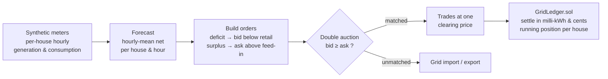

# GridShare

A peer-to-peer solar energy market for a small neighbourhood. Each house
forecasts its own generation and consumption, a double-auction matcher pairs
houses that have surplus solar with houses that need energy, and every matched
trade is settled on an EVM ledger contract. Whatever the market cannot match
is traded with the grid.

The goal is a clear, end-to-end example: a forecasting model, a market
mechanism with real economic meaning, and a smart contract that keeps an
auditable record of who gave energy to whom and for how much — without putting
any personal data on-chain.

[](.github/workflows/ci.yml)
[](pyproject.toml)
[](LICENSE)

---

## Why it matters

When several houses on the same street have solar panels, selling a surplus
back to the grid pays very little (the feed-in price), while buying from the
grid costs a lot (the retail price). A local market lets neighbours trade in
the gap between those two prices: the seller earns **more** than the grid would
pay, and the buyer pays **less** than the grid would charge. Both sides win,
and less energy has to travel over the wider network.

GridShare shows how that market can run every hour and how each trade can be
recorded on a shared, tamper-evident ledger that all participants can audit.

## How it works



1. **Meters (`generate.py`).** Synthetic, deterministic per-house hourly
   generation and consumption. Half the houses have panels (prosumers); the
   rest only consume.
2. **Forecast (`forecast.py`).** A simple, transparent baseline: the mean generation
   and consumption for each house at each hour of the day. It is easy to explain
   and a fair starting point; a stronger model can replace it behind the same
   interface.
3. **Market (`market.py`).** A uniform-price double auction. Buyers are sorted
   by bid (high to low) and sellers by ask (low to high); they are matched while
   a buyer still beats a seller, and all matched energy settles at one clearing
   price (the midpoint of the last matched pair). The rest trades with the grid.
4. **Chain (`chain/` + `contracts/`).** The `GridLedger` contract records every
   settled trade and keeps a running position per house: net energy (in
   milli-kWh) and net money (in cents). Houses are identified by a `bytes32`
   hash of their name, so no personal data reaches the chain. Only the market
   operator can settle.

The same market can settle against the real compiled contract (on an in-memory
PyEVM node or a live JSON-RPC endpoint such as Anvil) or against an in-memory
fake with identical accounting, so the tests and the API behave the same with
or without a chain.

## The market mechanism, precisely

`clear_market` is a uniform-price double auction implemented as a merge of two
sorted lists:

1. Sort buyers by bid descending and sellers by ask ascending — `O(n log n)`.
2. Walk both lists with two pointers while `bid ≥ ask`, trading
   `min(remaining_buyer, remaining_seller)` kWh at each step — a linear merge.
3. The **clearing price** is the midpoint of the *last* matched buyer/seller
   pair, and every matched kWh settles at that single price (uniform pricing),
   not at each pair's own midpoint.

The economic guarantee follows from the matching rule: a pair only trades when
`bid ≥ ask`, and since buyers bid below the grid retail price and sellers ask
above the grid feed-in price, the clearing price always lands **between** the two
grid prices. So the reported savings are always non-negative:

```
buyer_savings_cents  = p2p_kwh × (grid_retail − clearing_price)
seller_earnings_cents = p2p_kwh × (clearing_price − grid_feed_in)
```

Unmatched demand becomes `grid_import`, unmatched supply becomes `grid_export`.
In the demo, 20 houses trade ~72.9 kWh peer-to-peer in a simulated day.

## On-chain accounting: integers, not floats

The EVM has no floats, and floating-point positions would drift and disagree
between parties — defeating the point of a shared ledger. So the contract stores
energy as integer **milli-kWh** (1 kWh = 1000) and money as integer **cents**,
and computes `cents = kWhMilli × priceCents / 1000` with integer (truncating)
division — identical in Solidity and in the Python fake, which a test asserts by
settling the same trade on both and comparing positions bit for bit.

## Forecasting: a transparent baseline

`HourlyMeanForecaster` predicts each house's net energy as the mean of its
historical generation minus consumption at that hour of day. It is deliberately a
**baseline**, not a headline model: it is trained on every day except the last and
evaluated on the held-out last day, where it reaches a net **MAE of ~0.26 kWh**.
It exists to define the interface (`fit` / `forecast_net` / `mae`) and a clear
reference point; a weather-aware or gradient-boosted model can replace it without
touching the market or the chain. Reporting it plainly as a baseline, with the
interface ready for a stronger model to drop in, is the design intent.

## Quick start

```bash
python -m venv .venv && source .venv/bin/activate
pip install -e ".[dev]"

# Deploy to an in-memory EVM, simulate a day, and settle trades on-chain:
python -m gridshare.cli demo

# Run the HTTP API:
uvicorn gridshare.main:app --reload
```

Example API calls:

```bash
curl -s localhost:8000/health
curl -s -X POST localhost:8000/simulate/hour -d '{"hour": 12, "settle": true}' \
  -H 'content-type: application/json'
curl -s 'localhost:8000/simulate/day'
```

## The smart contract

`contracts/src/GridLedger.sol` is compiled with a pinned `solc-js` compiler, so
no native toolchain is needed and the path is identical locally and in CI:

```bash
make compile   # node contracts/compile.js -> contracts/artifacts/GridLedger.json
```

The compiled artifact (ABI + bytecode) is committed, so the runtime and the
tests can deploy the contract to any JSON-RPC endpoint without a compiler.

Key design points:

- **No personal data on-chain.** A house is a `bytes32` id, the hash of its
  name. The chain never sees who the house is.
- **Operator-only settlement.** Only the market clearinghouse can record a
  trade, which stops anyone from writing fake positions.
- **Custom errors** (`NotOperator`, `ZeroParty`, `SameParty`, `ZeroEnergy`)
  make reverts cheap and easy to read.

## Configuration

Settings load from environment variables with the `GS_` prefix (see
`.env.example`):

| Variable               | Default            | Meaning                                  |
| ---------------------- | ------------------ | ---------------------------------------- |
| `GS_N_HOUSES`          | `20`               | Houses in the neighbourhood              |
| `GS_GRID_BUY_CENTS`    | `80.0`             | Grid retail price (cents/kWh)            |
| `GS_GRID_SELL_CENTS`   | `20.0`             | Grid feed-in price (cents/kWh)           |
| `GS_CHAIN_ENABLED`     | `true`             | Settle trades on a real chain            |
| `GS_CHAIN_RPC_URL`     | `http://anvil:8545`| JSON-RPC endpoint                        |
| `GS_CONTRACT_ADDRESS`  | `""`               | Deployed `GridLedger` address            |
| `GS_CHAIN_PRIVATE_KEY` | `""`               | Operator key for signing settlements     |

Never commit a real private key. Leave `GS_CHAIN_PRIVATE_KEY` empty for local
runs; the API and tests use an in-memory EVM or the in-memory fake.

## Validated on real meter data

The synthetic generator is deterministic, which is ideal for tests. To show the
mechanism holds up on data no one designed, GridShare also runs on a **real**
neighbourhood: real hourly household consumption from the Low Carbon London
smart-meter trial, and a real solar capacity-factor profile measured from German grid
PV output (50Hertz zone, a summer fortnight), scaled to each prosumer's panels. The
arrays are vendored under `datasets/neighbourhood_real.npz` (see `datasets/README.md`
for provenance); `gridshare.real_data.load_real_neighbourhood` assembles them into the
same `(houses, history)` the market consumes, which `GridShareService` now accepts
directly. Run `python -m gridshare.real_benchmark`:

```
neighbourhood      : 20 houses, 10 with panels, 14 real days
grid tariff        : buy 80c / sell 20c per kWh
peer-to-peer traded: 71.5 kWh over the day
self-sufficiency   : 27.9% of demand met locally
clearing price     : 48.8c avg (all within the 20-80c spread: True)
buyer savings      : 23.05 $ vs the grid price
seller earnings    : 19.85 $ vs the feed-in
```

Because GridShare's market is deterministic (a double auction and tariff arithmetic,
not a trained model), there is nothing to over/underfit; the real-data question is
whether the mechanism produces sound, worthwhile outcomes on real meters. It does:
surplus solar from real prosumers clears into real neighbours' demand at a price
strictly inside the grid's buy/sell spread, so sellers earn more than the feed-in rate
and buyers pay less than retail — both sides ahead, with less energy drawn from the
wider grid. `tests/test_real_benchmark.py` asserts these invariants on the real
neighbourhood (the accounting identity, prices inside the spread, both-sides-win) and
that the economics respond to the inputs (closing the spread removes the advantage).

## Testing

```bash
ruff check gridshare tests
pytest --cov=gridshare --cov-report=term-missing --cov-fail-under=80
```

The suite covers the forecaster, the market mechanism, the HTTP API, the
contract (deployed to an in-memory EVM, including the operator and input
guards), and the **real-data benchmark** (the real neighbourhood loader, the
market invariants on real meters, the no-spread control, and the fetch path).
Tests that deploy the contract carry the `chain` marker.

## Documentation

- `docs/architecture.md` — the full picture and the data flow.
- `docs/adr/` — the main design decisions and why they were made.
- `docs/estudio/` — a study guide in Spanish, for learning the project in depth.

## License

[MIT](LICENSE) © Angelo David Padilla Romero
